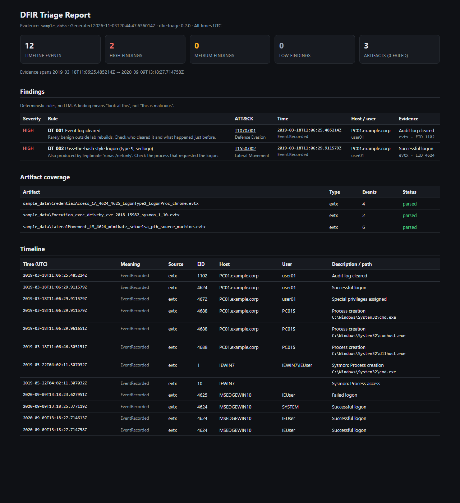
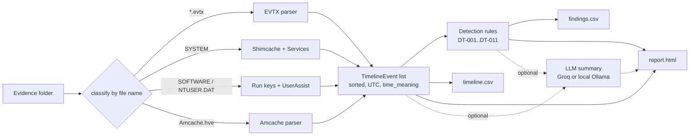

# DFIR Triage Automator

**Turns a folder of Windows forensic artifacts (event logs, Shimcache, Amcache, registry) into one timeline, runs ATT&CK-mapped detection rules over it, and writes a self-contained HTML triage report.**

[](https://github.com/yug3009p/dfir-triage-automator/actions/workflows/ci.yml)




*`report.html` from the bundled samples: the audit log is cleared (DT-001) four seconds before a pass-the-hash logon (DT-002).*

---

## The problem

In the first hour of a Windows incident, an analyst is handed a pile of artifacts and needs to answer: **what ran, when, as whom, and what persists?** The answers are spread across formats that each need their own tool: binary event logs, the Shimcache blob in the SYSTEM hive, Amcache, Run keys, services, UserAssist. Each one also records time differently.

## Why it matters

- **The signal is in the sequence.** `1102` (log cleared) followed seconds later by a type-9 logon is an attack story. Neither event alone is.
- **Timestamps lie if you misread them.** A Shimcache time is the file's last-modified time, not when it ran. A registry time belongs to the key, not the value. Every row in this tool's timeline carries a `time_meaning` column so these never get mixed up.
- **Triage should be repeatable.** The detection rules are plain code, not an LLM: the same evidence always gives the same findings, and each finding points to the exact event behind it.

Full-scale tools such as [Plaso](https://github.com/log2timeline/plaso) and Eric Zimmerman's tools do far more. This project is a small, readable, cross-platform alternative for first-pass triage, written to be understood line by line.

## Quickstart

```bash
git clone https://github.com/yug3009p/dfir-triage-automator.git
cd dfir-triage-automator
pip install .                          # use a virtualenv if you prefer
dfir-triage sample_data -o output      # writes report.html, timeline.csv, findings.csv
# open output/report.html in a browser
```

Or with Docker:

```bash
docker build -t dfir-triage .
docker run --rm --user "$(id -u):$(id -g)" -v "$PWD:/data" dfir-triage sample_data -o output
```

Real output on the bundled samples:

```
Parsed 3/3 artifacts, 12 events
HIGH   2 finding(s)
       DT-001 Event log cleared @ 2019-03-18T11:06:25.485214Z
       DT-002 Pass-the-hash style logon (type 9, seclogo) @ 2019-03-18T11:06:29.911579Z
Wrote output/report.html, timeline.csv, findings.csv
```

### Usage

```bash
dfir-triage ./evidence -o output                     # any folder layout, e.g. a KAPE output tree
dfir-triage ./evidence -o output --summarize ollama  # optional summary from a local model
dfir-triage ./evidence -o output --summarize groq    # ...or from Groq (needs GROQ_API_KEY, pip install ".[llm]")
```

Artifacts are recognised by file name: `*.evtx`, `SYSTEM`, `SOFTWARE`, `NTUSER.DAT` (the parent folder name is used as the user) and `Amcache.hve`. A file that fails to parse is listed in the report's coverage table instead of stopping the run.

A Streamlit UI for uploading a single `.evtx` is also included: `pip install ".[ui,llm]"`, then `streamlit run src/dfir_triage/app.py`.

## Architecture



| Module | Role |
|---|---|
| `schema.py` | `TimelineEvent`: the one row shape every parser produces |
| `parsers/evtx.py` | Event logs via python-evtx, including `UserData` fields |
| `parsers/shimcache.py` | Windows 10/11 AppCompatCache binary format |
| `parsers/amcache.py` | `InventoryApplicationFile` entries, including SHA-1 |
| `parsers/registry.py` | Run/RunOnce, Services, UserAssist (ROT13-decoded) |
| `hive.py` | The few python-registry calls the parsers use, so tests can use fake keys |
| `timeline.py` | Finds artifacts, runs parsers, records per-file errors, writes CSV |
| `rules.py` | Deterministic ATT&CK rules |
| `report.py` + `templates/` | HTML report, autoescaped |
| `summarizer.py` | Optional LLM write-up |
| `cli.py` | `dfir-triage` command |

## What each timestamp means

| `time_meaning` | Source | Meaning |
|---|---|---|
| `EventRecorded` | EVTX | When Windows wrote the event |
| `FileLastModified` | Shimcache | The file's last-modified time. Not an execution time, and an entry alone does not prove execution on Windows 10/11 |
| `KeyLastWrite` | Amcache, Run keys, Services | Last write to the registry key, which may cover several values |
| `LastExecuted` | UserAssist | Last launch through Explorer |

## Detection rules

`src/dfir_triage/rules.py` runs these rules over every timeline event. A finding means "look at this", not "this is malicious"; each rule carries a note on common benign causes.

| ID | Rule | ATT&CK | Severity | Evidence |
|---|---|---|---|---|
| DT-001 | Event log cleared | T1070.001 | High | Security 1102, System 104 |
| DT-002 | Pass-the-hash style logon (type 9, seclogo) | T1550.002 | High | Security 4624 |
| DT-003 | Process accessed LSASS memory | T1003.001 | High | Sysmon 10 |
| DT-004 | Encoded PowerShell command line | T1059.001 | High | Security 4688, Sysmon 1 |
| DT-005 | Service launches a shell, script host or user-writable binary | T1543.003 | High | System 7045, Security 4697, SYSTEM hive Services |
| DT-006 | New service installed | T1543.003 | Medium | System 7045, Security 4697 |
| DT-007 | Scheduled task created | T1053.005 | Medium | Security 4698 |
| DT-008 | Local account created | T1136.001 | Medium | Security 4720 |
| DT-009 | Account added to a security group | T1098 | Medium | Security 4728, 4732, 4756 |
| DT-010 | Program executed from a user-writable folder | T1204.002 | Medium | 4688, Sysmon 1, Shimcache, Amcache, UserAssist |
| DT-011 | Registry Run key autostart entry | T1547.001 | Low | SOFTWARE / NTUSER.DAT Run, RunOnce |

Each rule is tested against an event that must match and a similar one that must not. A test also fails if a rule is missing from this table.

## Event ID descriptions

The EVTX parser labels these IDs in plain English; everything else is kept and labelled `Other`. Sysmon IDs are looked up separately because they collide with other channels (Sysmon `1` is not Security `1`).

| Channel | Event IDs |
|---|---|
| Security | 1102 log cleared · 4624 / 4625 logon success / failure · 4634 logoff · 4648 explicit-credential logon · 4672 special privileges · 4688 process creation · 4697 service installed · 4698 scheduled task · 4720 account created · 4724 password reset · 4728 / 4732 / 4756 group membership · 4740 lockout |
| System | 104 log cleared · 7036 service state change · 7045 service installed |
| PowerShell | 4104 script block |
| Sysmon | 1 process creation · 3 network connection · 7 image loaded · 8 CreateRemoteThread · 10 process access · 11 file create · 13 registry value set · 22 DNS query |

## Optional LLM summary

`--summarize` sends the rule findings and the first 200 timeline rows to a model and embeds its five-section write-up in the report, marked as advisory. `ollama` keeps the evidence on your machine; `groq` sends it to a hosted API, so use it only with evidence you are allowed to share. The evidence is untrusted (a log field can contain text written to manipulate a model), so the prompt tells the model never to follow instructions found in it, and the report escapes all model output.

## Validation status

| Component | How it is tested | Status |
|---|---|---|
| EVTX parser | 3 public attack captures from EVTX-ATTACK-SAMPLES + unit tests | Done |
| Detection rules | Positive and negative case per rule; exact findings on the samples | Done |
| HTML report | Rendering, truncation, failure display, and an XSS-escaping test | Done |
| Shimcache, Amcache, registry parsers | Unit tests, plus an automated lab run on a real Windows 11 26H2 VM checked against ground truth recorded in the VM | Done for Shimcache, Amcache SHA-1, Run keys and Services: 18 passed, 0 failed, 3 warnings; Amcache SHA-1 matched 8 of 8 real files. UserAssist not yet confirmed on real data. See [docs/validation-results.md](docs/validation-results.md) |

CI runs lint and the test suite on Ubuntu and Windows (Python 3.11 and 3.12) and builds the Docker image.

## Limitations

- Shimcache: Windows 10/11 format only. Amcache: Windows 10 1709+ `Inventory` format only.
- Registry transaction logs are not replayed, so very recent changes in a "dirty" hive can be missing.
- Not yet parsed: Prefetch, $MFT, SRUM, LNK / Jump Lists, browser history.
- Rules look at one event at a time; there is no correlation yet (for example "20 failed logons in a minute").
- The bundled samples are small (12 events). They show the pipeline works, not how it scales.

## Roadmap

- **v1.1:** Prefetch (Windows 10/11 compressed format), parsers for AI coding agent session logs, an allowlist to cut DT-006 noise from legitimate service installs, and a lab comparison against Eric Zimmerman's tools.
- Correlation rules (brute force bursts, log clear followed by logon).
- Optional Sigma rule support for EVTX.

## Data and attribution

- `sample_data/` holds three unmodified captures from [EVTX-ATTACK-SAMPLES](https://github.com/sbousseaden/EVTX-ATTACK-SAMPLES) by Samir Bousseaden, licensed **GPL-3.0** (see [sample_data/NOTICE.md](sample_data/NOTICE.md)). They contain no real organisational data.
- Built on [python-evtx](https://github.com/williballenthin/python-evtx) and [python-registry](https://github.com/williballenthin/python-registry) by Willi Ballenthin (Apache-2.0), and [MITRE ATT&CK](https://attack.mitre.org/).

## Security

Analyse only evidence you are authorised to handle. See [SECURITY.md](SECURITY.md) for how to report a vulnerability and how the tool treats untrusted evidence.

## Contributing

See [CONTRIBUTING.md](CONTRIBUTING.md). Changes are listed in [CHANGELOG.md](CHANGELOG.md).

## License

Code: [MIT](LICENSE). Sample data: GPL-3.0, see above.

## Author

**Yug Mukesh Patel**: [LinkedIn](https://www.linkedin.com/in/yugpatel9409/) · [GitHub](https://github.com/yug3009p)
